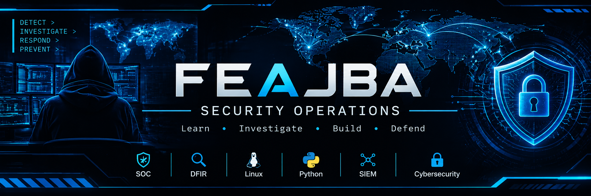

  

 

# Hi, I'm Alphonse 

  

I'm a cybersecurity student passionate about security operations, threat detection, digital forensics, and understanding how attackers approach systems.

My interest in cybersecurity goes beyond protecting systems. I enjoy thinking from an adversary's perspective, investigating weaknesses, understanding suspicious behaviour, and exploring how security incidents happen.

I believe effective security comes from understanding both sides: how systems are protected and how they can be attacked.

## Areas of Interest

- Security Operations Centre (SOC)
- Threat Detection & Threat Hunting
- Incident Response
- Digital Forensics
- SIEM & Log Analysis
- Linux and Windows Security
- Python Security Automation

##  Tools & Technologies

<h2 align="center">⚡ TECHNICAL ARSENAL</h2>

  
  
  
  

  
  
  
  

  
  
  

##  Featured Projects

<h2 align="center"> FEATURED SECURITY PROJECTS</h2>

<table>
<tr>
<td width="50%">
<h3 align="center"> AlertPulse</h3>

SOC Alert Triage Engine

Automated alert processing, deduplication and risk-based prioritization.

<a href="https://github.com/FEAJBA/alertpulse-triage-engine">
View Project →
</a>

</td>
<td width="50%">
<h3 align="center"> LoginGuard</h3>

Brute Force Detection

Detecting suspicious login patterns and potential brute-force activity.

<a href="https://github.com/FEAJBA/loginguard-brute-force-detector">
View Project →
</a>

</td>
</tr>
<tr>
<td width="50%">
<h3 align="center"> API Honeypot</h3>

SOC Alerting & Monitoring

Monitoring simulated malicious API interactions and generating security alerts.

<a href="https://github.com/FEAJBA/API-honeypot-SOC-alerting">
View Project →
</a>

</td>
<td width="50%">
<h3 align="center"> API Log Anomaly Detector</h3>

Suspicious Activity Detection

Identifying unusual API activity through log analysis and anomaly detection.

<a href="https://github.com/FEAJBA/API-Log-Anomaly-Detector">
View Project →
</a>

</td>
</tr>
</table>

## Currently Learning

- Advanced SIEM investigations
- Threat hunting and detection engineering
- Digital forensics and incident response
- Security automation with Python

## Career Goal

Working towards becoming a skilled SOC Analyst, developing practical investigation skills and contributing to defensive security operations.

---

*Learning, investigating, building, and documenting one project at a time.*
*Learning, investigating, building, and documenting one project at a time.*

<h2 align="center"> GITHUB ANALYTICS</h2>

  
  

  

